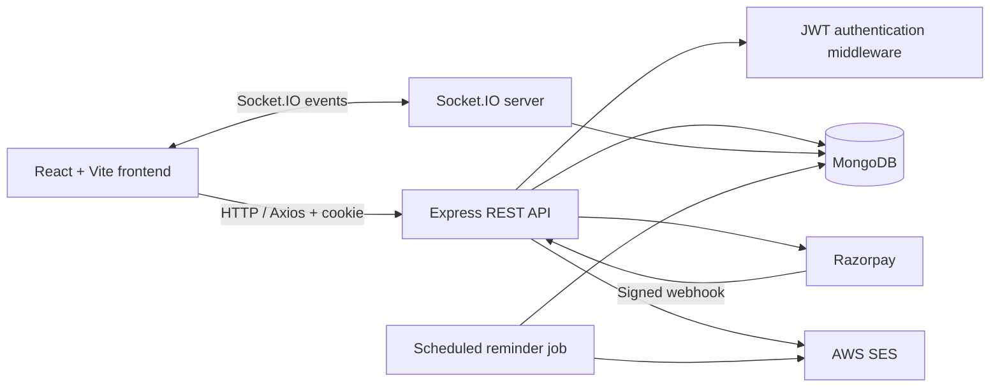

DevTinder
A full-stack developer networking platform inspired by swipe-based connection apps. DevTinder lets developers create profiles, discover other developers, send and review connection requests, chat with accepted connections in real time, and purchase premium membership.
This documentation was prepared against the current shahbaz806/dev-tinder backend (main) and shahbaz806/devTinder-web frontend (master) repositories. Where the checked-in implementation has a limitation or a configuration that should be improved, it is called out instead of being presented as a completed feature.

Repositories
Part	Repository	Stack
Frontend	devTinder-web	React, Vite, Redux Toolkit, React Router, Axios, Tailwind CSS, DaisyUI
Backend	dev-tinder	Node.js, Express 5, MongoDB, Mongoose, JWT, Socket.IO

The frontend and backend are maintained as separate repositories.
Features
- Authentication: signup, login, logout and cookie-based JWT authentication.
- Developer profile: view and edit profile information, including name, age, gender, about, skills and profile photo.
- Developer feed: paginated user discovery; the logged-in user and users with an existing connection-request relationship are excluded.
- Connection requests: send interested or ignored requests; review received interested requests as accepted or rejected.
- Connections: list accepted connections.
- Real-time chat: Socket.IO rooms for two participants; messages are stored in MongoDB and delivered live.
- Premium membership: Razorpay order creation, payment verification, webhook signature validation and premium activation.
- Password reset flow: reset-token fields and endpoints are present. The current reset-link handler logs the generated link rather than sending a complete production email flow.
- Email notifications: AWS SES integration and a scheduled job for pending connection-request reminders.
Tech stack
Frontend
- React 19 + Vite
- React Router
- Redux Toolkit + React Redux
- Axios
- Socket.IO Client
- Tailwind CSS 4 + DaisyUI 5
- lucide-react
- React lazy loading and Suspense for route-level code splitting
Backend
- Node.js (CommonJS)
- Express 5
- MongoDB + Mongoose
- JSON Web Tokens (jsonwebtoken)
- bcrypt for password hashing
- cookie-parser, cors
- Socket.IO
- Razorpay SDK
- AWS SDK SES client
- node-cron and date-fns
- validator
High-level architecture

See [architecture.md](./architecture.md) for the component responsibilities and request flows.
Getting started
Prerequisites
- Node.js and npm
- A MongoDB database (local MongoDB or MongoDB Atlas)
- Razorpay credentials if you want to test premium checkout
- AWS SES credentials and a verified sender/recipient setup if you want to test email notifications
1. Clone both repositories
git clone https://github.com/shahbaz806/dev-tinder.git
git clone https://github.com/shahbaz806/devTinder-web.git
2. Start the backend
cd dev-tinder
npm install
Create a .env file in the backend root. Use your own credentials; never commit this file.
MONGO_SECRET=your_mongodb_connection_string
JWT_SECRET=replace_with_a_long_random_secret
RAZORPAY_KEY_ID=your_razorpay_key_id
RAZORPAY_KEY_SECRET=your_razorpay_key_secret
RAZORPAY_WEBHOOK_SECRET=your_razorpay_webhook_secret
ACCESS_KEY=your_aws_access_key_id
AWS_SES_SECRET=your_aws_secret_access_key
NODE_ENV=development
The backend currently reads the MongoDB connection string from MONGO_SECRET. The payment and SES utilities read the corresponding Razorpay and AWS variables shown above.

Run the API:
npm run dev
The checked-in backend starts the HTTP and Socket.IO server on port 3000.
3. Start the frontend
Open a second terminal:
cd devTinder-web
npm install
npm run dev
Vite starts the frontend (normally at http://localhost:5173).

Check src/utils/constant.js and configure BASE_URL to point to the backend API. The backend's checked-in CORS configuration currently allows http://localhost:5173; update it for your deployed frontend domain before production use.
4. Production build
cd devTinder-web
npm run build
Vite generates the production bundle in dist/.

The frontend has previously been deployed as static files to an Ubuntu EC2 instance behind Nginx. For client-side routes such as /connections and /chat/:targetUserId, configure Nginx to fall back to index.html.
API overview
All route modules are mounted at / in the Express application. Protected endpoints require the authentication cookie.
Method	Endpoint	Auth	Purpose
POST	/signup	No	Create an account
POST	/login	No	Authenticate and issue JWT cookie
POST	/logout	No	Clear the login cookie
GET	/profile/view	Yes	Get the logged-in user's profile
PATCH	/profile/edit	Yes	Update allowed profile fields
POST	/profile/password	No	Generate a password-reset token
PATCH	/reset-password/:token	No	Set a new password using a valid token
POST	/request/send/:status/:toUserId	Yes	Send an ignored or interested request
POST	/request/review/:status/:requestId	Yes	Accept or reject a received request
GET	/user/request/recieved	Yes	Get received pending requests
GET	/user/connection	Yes	Get accepted connections
GET	/feed?page=1&limit=10	Yes	Get paginated developer feed
GET	/chat/:targetUserId	Yes	Get or create a conversation
POST	/payment/create	Yes	Create a Razorpay order
POST	/payment/verify	Yes	Verify a Razorpay payment
POST	/payment/webhook	Razorpay signature	Process Razorpay webhook
GET	/premium/verify	Yes	Get premium membership status

Note: The received-request route is spelled /user/request/recieved in the current backend. Preserve that spelling in the frontend until the API is renamed consistently.
Premium membership
The backend's current src/utils/constant.js defines these order amounts:
Membership key	Amount
silver	₹300
gold	₹700

The backend converts the amount to paise when creating a Razorpay order. Keep the frontend plan prices and backend memberShipAmount values synchronized.

The payment flow is:
1. Frontend calls POST /payment/create with memberShipType.
2. Backend creates a Razorpay order and stores a Payment record.
3. Razorpay Checkout returns order, payment and signature values.
4. Frontend calls POST /payment/verify.
5. Backend validates the signature and fetches the payment from Razorpay before activating premium.
6. Razorpay can also notify POST /payment/webhook; the backend validates the webhook signature and processes captured payments.
Database
The application currently has four Mongoose models:
- User
- ConnectionRequest
- Chat
- Payment
See [databaseDesign.md](./databaseDesign.md) for fields, references, relationship diagrams and index notes.
Project structure
Backend (dev-tinder)
src/
├── app.js
├── config/
│   └── database.js
├── middlewarse/
│   └── auth.js
├── modals/
│   ├── user.js
│   ├── connectionRequest.js
│   ├── chat.js
│   └── payment.js
├── routes/
│   ├── auth.js
│   ├── profile.js
│   ├── request.js
│   ├── user.js
│   ├── chat.js
│   └── payment.js
└── utils/
    ├── constant.js
    ├── cronJob.js
    ├── razorPay.js
    ├── sendEmail.js
    ├── sesClient.js
    ├── socket.js
    └── validation.js
The folder is currently named middlewarse and the model folder modals in the repository. These names are retained here to match the actual code.
Frontend (devTinder-web)
src/
├── App.jsx
├── main.jsx
├── index.css
├── Components/
│   ├── Body.jsx
│   ├── NavBar.jsx
│   ├── Footer.jsx
│   ├── Login.jsx
│   ├── Feed.jsx
│   ├── FeedContent.jsx
│   ├── UserCard.jsx
│   ├── Profile.jsx
│   ├── EditProfile.jsx
│   ├── Connection.jsx
│   ├── ConnectionList.jsx
│   ├── Request.jsx
│   ├── RequestContent.jsx
│   ├── RequestCard.jsx
│   ├── Chat.jsx
│   ├── ChatHeader.jsx
│   ├── Premium.jsx
│   ├── Premium/
│   └── Context/
└── utils/
    ├── appStore.js
    ├── constant.js
    └── Redux slices and shared utilities
This is a representative structure; the repository may contain additional components and utility files.
Important production checklist
The following are security and reliability improvements to complete before treating the application as production-hardened:
- [ ] JWT secret: the checked-in authentication middleware currently verifies tokens with a literal secret instead of process.env.JWT_SECRET. Move it to an environment variable, rotate the exposed value, and invalidate old sessions.
- [ ] Cookie settings: apply httpOnly, secure (in production), and an intentional sameSite policy consistently to signup, login and logout cookies.
- [ ] CORS: replace the hard-coded localhost origin with a validated environment-based frontend origin.
- [ ] Socket.IO authentication: authenticate the socket handshake and authorize room membership server-side. Do not trust client-supplied user IDs as proof of identity.
- [ ] Chat authorization: verify that both participants are accepted connections before returning or sending messages.
- [ ] Password reset: send reset links through a verified email provider, use a frontend HTTPS URL, rate-limit requests, and avoid revealing whether an email exists.
- [ ] Input validation: validate ObjectIds, request bodies, message lengths and all user-controlled values.
- [ ] Database indexes: add and verify indexes for frequently queried connection and chat lookups; avoid assuming that a query is indexed unless the index exists.
- [ ] Secrets: rotate any credentials that were ever committed, remove them from repository history where appropriate, and keep all secrets in environment variables or a secrets manager.
- [ ] Payment handling: keep webhook signature verification, idempotency checks and server-side payment status verification enabled.
Documentation
- [README.md](./README.md) — project overview, setup, features and API list.
- [databaseDesign.md](./databaseDesign.md) — MongoDB collections, fields and relationships.
- [architecture.md](./architecture.md) — application layers, request flows and deployment view.